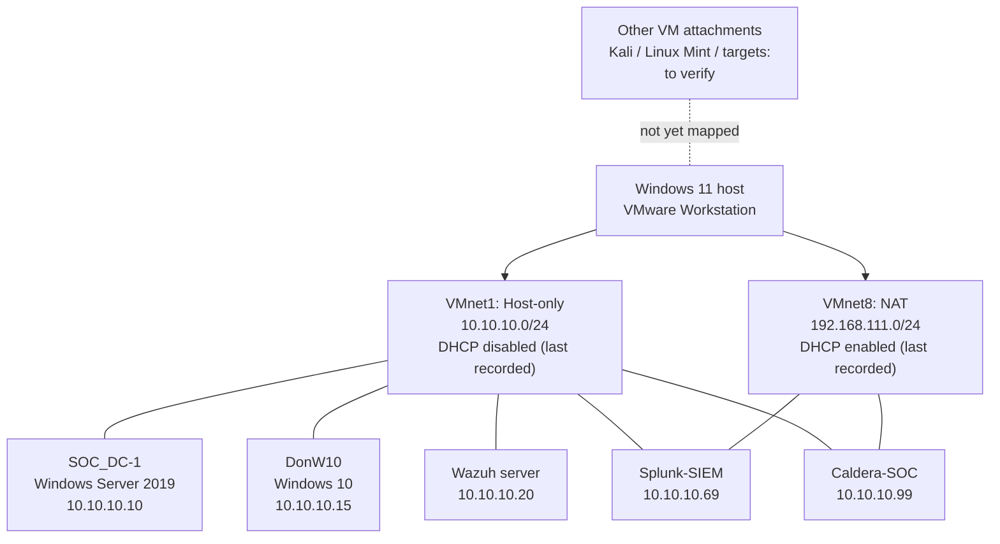

# VMware SOC lab architecture

> **Status: Baseline draft — pending verification against VMware Workstation.**  
> **Evidence date:** Details below were last recorded during the lab walkthrough on **16–18 October 2026**, not independently inspected on 23 October 2026. Do not treat this document as a current configuration export.

## Purpose and scope

This document describes the virtualised blue-team lab used for Security Operations Centre (SOC) practice: identity services, Windows endpoint logging, security information and event management (SIEM), network monitoring, and authorised adversary simulation.

**Host:** Windows 11 PC running VMware Workstation. The lab was migrated from Hyper-V; older `Internal-Net` / `External-Net` switch information relates to the former environment and should **not** be copied into the current VMware configuration.

## Network inventory — last recorded

| Network | VMware connection type | Subnet | DHCP | Verification |
| --- | --- | --- | --- | --- |
| VMnet1 | Host-only (isolated lab network) | `10.10.10.0/24` | Disabled | Recorded 16 Oct; recheck in Virtual Network Editor |
| VMnet8 | NAT (Network Address Translation) | `192.168.111.0/24` | Enabled | Recorded 16 Oct; recheck in Virtual Network Editor |

**Caution:** NAT does not by itself mean that *all* traffic is isolated from other networks. Confirm individual VM adapter assignments, host routing, firewall rules and access boundaries before running attack simulations. DHCP and gateway addresses may have changed.

## Virtual machine inventory — last recorded

These are previously discussed lab values, not a scan of the current system. Missing values are intentionally left unfilled.

| VM name / role | Operating system / service | Recorded host-only address | Network adapters | Status |
| --- | --- | --- | --- | --- |
| `SOC_DC-1` | Windows Server 2019 / Active Directory Domain Services (AD DS) / DNS | `10.10.10.10` | Current NIC configuration unverified | Recorded 16 Oct |
| `DonW10` | Windows 10 Pro / domain client, Sysmon and event forwarding | `10.10.10.15` | Current NIC configuration unverified | Recorded 16 Oct |
| Ubuntu Wazuh server (VM display name to confirm) | Wazuh manager / dashboard | `10.10.10.20` | Current NIC configuration unverified | Recorded 16 Oct |
| `Splunk-SIEM` | Splunk Enterprise | `10.10.10.69` | VMnet1 host-only + VMnet8 NAT | Recorded 18 Oct |
| `Caldera-SOC` | MITRE CALDERA adversary emulation | `10.10.10.99` | Host-only + NAT; exact NIC order to confirm | Recorded 18 Oct |
| Kali Linux (VM name to confirm) | Authorised attack simulation | To verify | To verify | Inventory pending |
| Linux Mint (VM name to confirm) | Wireshark / monitoring workstation | To verify | To verify | Inventory pending |
| Other VM(s), if present | E.g. dedicated vulnerable test targets | To verify | To verify | Inventory pending |

**Domain:** `lab.local` (previously configured; DNS membership and current DC name require revalidation).

## Architecture diagram — *working baseline, not verified final topology*

The diagram below represents the two VMware networks and **only the previously recorded VM attachments**. Links do not imply a successful test of reachability, firewall permissions or telemetry flow.

**Important:** The connections for the DC, endpoint and Wazuh depict their recorded **lab-subnet presence**; their actual VMnet device settings must still be checked in VMware before this is treated as a final wiring diagram.

## High-level security data flows — to validate

- `DonW10` Windows Event Logs and Sysmon events → log collection / Wazuh agent and/or Splunk forwarder.
- Wazuh manager → dashboard and alert analysis.
- Splunk forwarder → Splunk receiving port `9997/TCP` (recorded in lab work; validate current listener).
- Splunk web console → `8000/TCP` (recorded in lab work; validate current listener).
- CALDERA ↔ authorised test endpoints only, with network access and endpoint safeguards reviewed in advance.

**No claims are made here that each data flow is currently working.** We will test and document them separately.

## Verification checklist

- [ ] Capture the **VMware Workstation Library** showing the VM display names, with personal details redacted.
- [ ] Open **Edit → Virtual Network Editor** and verify VMnet1/VMnet8 connection type, subnet and DHCP.
- [ ] For each VM, open **VM → Settings** and record every Network Adapter connection type.
- [ ] On each VM, record hostname, interface name, IPv4 address/prefix, default gateway and DNS server.
- [ ] Record which adapters are static versus DHCP-assigned.
- [ ] Confirm that the domain client resolves the AD DNS server and that services can reach their expected log destinations.
- [ ] Add a verified network diagram and note the date of the observation.
- [ ] Sanitise screenshots, configuration snippets, routes and addresses before any future public release.

## Step-by-step collection sequence

**Step 4.1 — Current VM inventory:** Start with a screenshot of the VMware Workstation Library showing all the VM names. A screenshot is preferred over assumptions from historic notes.

**Step 4.2 — VMware virtual networks:** Record the Virtual Network Editor values for VMnet1 and VMnet8.

**Step 4.3 — VM-to-network wiring:** Record adapter settings for each VM, including any second adapter.

**Step 4.4 — Guest IP and DNS:** Validate addresses and network routes inside the running VMs; preserve only redacted evidence.

**Step 4.5 — Final map:** Replace this draft with an evidence-based diagram and mark the revision as verified.

## Handling evidence safely

This repository is currently private, but private repositories can still be accidentally shared. Do **not** upload raw VM disks, memory snapshots, password vaults, authentication tokens, private keys, credential-bearing exports, or raw packet captures. Review screenshots for passwords, tokens, public IPs and personal information. Use intentionally sanitised samples for the public-facing portfolio.

## Change history

| Date | Change | Verification |
| --- | --- | --- |
| 2026-10-23 | Initial architecture draft based on earlier VMware walkthrough | **Pending current-state validation** |
