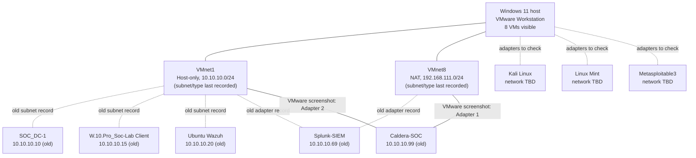

# VMware SOC lab architecture

> **Status: VM inventory verified from a VMware Workstation screenshot (23 October 2026); IP address and full network configuration still require live verification.**  
> **Evidence:** VMware Workstation Library screenshot supplied on **23 October 2026**. Earlier network and IP details were recorded during the walkthrough on **16–18 October 2026**. Keep these different evidence sources distinct.

## Purpose and scope

This document describes the virtualised blue-team lab used for Security Operations Centre (SOC) practice: identity services, Windows endpoint logging, security information and event management (SIEM), network monitoring, and authorised adversary simulation.

**Host:** Windows 11 PC running VMware Workstation. The lab was migrated from Hyper-V; older `Internal-Net` / `External-Net` switch information relates to the former environment and should **not** be copied into the current VMware configuration.

## Network inventory — last recorded

| Network | VMware connection type | Subnet | DHCP | Verification |
| --- | --- | --- | --- | --- |
| VMnet1 | Host-only (isolated lab network) | `10.10.10.0/24` | Disabled | Recorded 16 Oct; recheck in Virtual Network Editor |
| VMnet8 | NAT (Network Address Translation) | `192.168.111.0/24` | Enabled | Recorded 16 Oct; recheck in Virtual Network Editor |

**Caution:** NAT does not by itself mean that *all* traffic is isolated from other networks. Confirm individual VM adapter assignments, host routing, firewall rules and access boundaries before running attack simulations. DHCP and gateway addresses may have changed.

## VMware Workstation Library — screenshot verified 23 October 2026

The screenshot confirms **eight VM display names** in the current VMware Workstation Library. The names are transcribed as shown, preserving their punctuation. These are **display names**, not necessarily each guest operating system's hostname.

| VM display name — verified screenshot | Intended role / earlier lab history | Last recorded VMnet1 IP (unverified today) | Network adapter details | Evidence |
| --- | --- | --- | --- | --- |
| `Kali Linux` | Authorised attack simulation | Not yet recorded | To check in VM Settings | Visible in Library |
| `Linux Mint` | Wireshark / network monitoring | Not yet recorded | To check in VM Settings | Visible in Library |
| `Metasploitable3` | Deliberately vulnerable training target | Not yet recorded | To check in VM Settings | Visible in Library |
| `SOC_DC-1` | Previously configured Windows Server 2019 / Active Directory Domain Services (AD DS) / DNS | `10.10.10.10` | To check in VM Settings | Name visible; IP from prior notes |
| `Ubuntu Wazuh` | Wazuh manager / dashboard | `10.10.10.20` | To check in VM Settings | Name visible; IP from prior notes |
| `W.10.Pro_Soc-Lab Client` | Windows 10 domain client; guest hostname previously recorded as `DonW10` | `10.10.10.15` | To check in VM Settings | Display name visible; hostname/IP from prior notes |
| `Splunk-SIEM` | Splunk Enterprise | `10.10.10.69` | Previously recorded VMnet1 + VMnet8; recheck | Name visible; connections/IP from prior notes |
| `Caldera-SOC` | MITRE CALDERA adversary emulation | `10.10.10.99` | **Adapter 1: Custom (VMnet8); Adapter 2: Custom (VMnet1)** | **Both adapters screenshot verified**; IP from prior notes |

### Screenshot-verified CALDERA VM details

- **VM display name:** `Caldera-SOC`
- **Power state at capture:** Powered off
- **Allocated memory:** 8 GB
- **Processors:** 4 (VMware summary)
- **Virtual disk:** 60 GB SCSI disk (summary label is truncated; allocation details not independently verified)
- **Network Adapter:** Custom (`VMnet8`)
- **Network Adapter 2:** Custom (`VMnet1`)
- **VM configuration path:** Present in the screenshot but intentionally omitted from the repository to avoid exposing host filesystem details

**Note:** The screenshot does **not** prove the IP addresses or DHCP settings shown elsewhere in this document; it confirms names and CALDERA's visible VM hardware configuration.

**Previously configured AD domain:** `lab.local` (guest domain membership, DNS settings and current hostnames still require revalidation).

## Architecture diagram — *partially verified as of 23 October 2026*

**Solid edges** show CALDERA's VMware adapter connections directly visible in the screenshot. **Dashed edges** reflect previously recorded lab-subnet membership or networking and require live validation. The diagram does not establish live reachability, routing or any successful attack.

## High-level security data flows — to validate

- `DonW10` Windows Event Logs and Sysmon events → log collection / Wazuh agent and/or Splunk forwarder.
- Wazuh manager → dashboard and alert analysis.
- Splunk forwarder → Splunk receiving port `9997/TCP` (recorded in lab work; validate current listener).
- Splunk web console → `8000/TCP` (recorded in lab work; validate current listener).
- CALDERA ↔ authorised test endpoints only, with network access and endpoint safeguards reviewed in advance.

**No claims are made here that each data flow is currently working.** We will test and document them separately.

## Verification checklist

- [x] Verify all **eight VMware Workstation Library** display names from the screenshot dated 23 October 2026. Raw screenshot was **not** committed because it exposes local host path information.
- [ ] Open **Edit → Virtual Network Editor** and verify VMnet1/VMnet8 connection type, subnet and DHCP.
- [ ] For each VM, open **VM → Settings** and record every Network Adapter connection type (CALDERA's two VMnet assignments already verified from its summary).
- [ ] On each VM, record hostname, interface name, IPv4 address/prefix, default gateway and DNS server.
- [ ] Record which adapters are static versus DHCP-assigned.
- [ ] Confirm that the domain client resolves the AD DNS server and that services can reach their expected log destinations.
- [ ] Add a verified network diagram and note the date of the observation.
- [ ] Sanitise screenshots, configuration snippets, routes and addresses before any future public release.

## Step-by-step collection sequence

**Step 4.1 — Current VM inventory: COMPLETE (display names).** A VMware Workstation Library screenshot supplied 23 October 2026 identifies eight VMs. CALDERA's memory, CPU count, disk capacity, power state and two virtual networks were also visible.

**Step 4.2 — VMware virtual networks: NEXT.** In VMware Workstation open **Edit → Virtual Network Editor** and capture its VMnet1/VMnet8 network type, subnet and DHCP settings. Screenshot may be reviewed in conversation before anything is committed.

**Step 4.3 — VM-to-network wiring:** Record adapter settings for each VM, including any second adapter.

**Step 4.4 — Guest IP and DNS:** Validate addresses and network routes inside the running VMs; preserve only redacted evidence.

**Step 4.5 — Final map:** Replace this draft with an evidence-based diagram and mark the revision as verified.

## Handling evidence safely

This repository is currently private, but private repositories can still be accidentally shared. Do **not** upload raw VM disks, memory snapshots, password vaults, authentication tokens, private keys, credential-bearing exports, or raw packet captures. Review screenshots for passwords, tokens, public IPs and personal information. Use intentionally sanitised samples for the public-facing portfolio.

## Change history

| Date | Change | Verification |
| --- | --- | --- |
| 2026-10-23 | Initial architecture draft based on earlier VMware walkthrough | Older network and IP values unverified |
| 2026-10-23 | Reconciled eight VM display names and Caldera-SOC summary settings from user-provided VMware Library screenshot | VM names and Caldera-SOC adapters **screenshot verified**; other VM networks and guest IPs pending |
