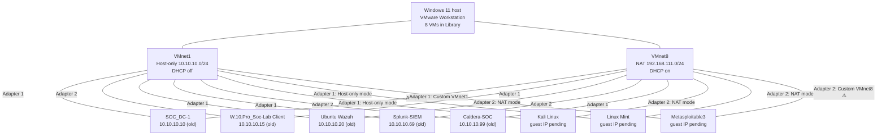

# VMware SOC lab architecture

> **Status: Eight of eight VMware VM network adapter configurations documented as of 23 October 2026.** Six profiles A–F mapped by the lab owner and two directly identified in VMware Library screenshots. **Guest IPs, gateway and DNS still require verification.**  
> **Evidence:** VMware Workstation Library and Virtual Network Editor screenshots supplied on **23 October 2026**. VM IPs and some connection assumptions below were recorded during the **16–18 October 2026** walkthrough. These older observations are not current guest configuration evidence.

## Purpose and scope

This document describes the virtualised blue-team lab used for Security Operations Centre (SOC) practice: identity services, Windows endpoint logging, security information and event management (SIEM), network monitoring, and authorised adversary simulation.

**Host:** Windows 11 PC running VMware Workstation. The lab was migrated from Hyper-V; older `Internal-Net` / `External-Net` switch information relates to the former environment and should **not** be copied into the current VMware configuration.

## Network inventory — screenshot verified 23 October 2026

The following VMware virtual network settings are **confirmed from the Virtual Network Editor screenshot**, except where specifically qualified:

| Network | Connection type | Subnet shown | Host connection | Local DHCP | Subnet mask | Evidence |
| --- | --- | --- | --- | --- | --- | --- |
| `VMnet1` | Host-only | `10.10.10.0` | Connected | Disabled | `255.255.255.0` (`/24`) | Type, table row and detailed VMnet1 pane |
| `VMnet8` | NAT (Network Address Translation) | `192.168.111.0` | Connected | Enabled | `255.255.255.0` (`/24`) | VMnet8 detailed pane screenshot dated 23 Oct 2026 |

**VMnet1 details:** Host virtual adapter enabled and labelled `VMware Network Adapter VMnet1`; the `Use local DHCP service to distribute IP address to VMs` option is unchecked. VMware displays `10.10.10.0` with `255.255.255.0` mask.

**VMnet8 details:** Network type NAT, host connection Connected, DHCP Enabled and subnet address `192.168.111.0`. A second screenshot, with VMnet8 selected, confirms subnet mask `255.255.255.0` (`/24`), the enabled `VMware Network Adapter VMnet8` host adapter, and the enabled local DHCP service. The **NAT gateway address is not shown** and remains unverified.

**Segmentation note:** Host-only means VMnet1 is not directly bridged to the physical LAN; the VMware host can still communicate over its virtual adapter. Any guest with both host-only and NAT NICs might bridge or route between networks if configured to do so. NAT is not a complete isolation control. Validate guest routes and firewall rules before adversary-emulation exercises.

## VMware Workstation Library — screenshot verified 23 October 2026

The screenshot confirms **eight VM display names** in the current VMware Workstation Library. Names are transcribed as shown. Six adapter profiles were later associated with these display names by the lab owner (A–F mapping); their settings came from Hardware screenshots that did not themselves identify the VM. Linux Mint and Metasploitable3 adapter summaries were subsequently confirmed by separate named Library screenshots. These are **display names**, not necessarily each guest operating system's hostname.

| VM display name — verified screenshot | Intended role / earlier lab history | Last recorded VMnet1 IP (unverified today) | Network adapter details | Evidence |
| --- | --- | --- | --- | --- |
| `Kali Linux` | Authorised attack simulation | Not yet recorded | Adapter 1: Host-only; Adapter 2: NAT (automatic settings) | Owner mapping: Pair E |
| `Linux Mint` | Wireshark / network monitoring | Not yet recorded | Adapter 1: Host-only mode; Adapter 2: NAT mode | **Named Library screenshot**; 8 GB RAM, 4 processors, 127 GB SCSI; powered off |
| `Metasploitable3` | Deliberately vulnerable training target | Not yet recorded | Adapter 1: Custom VMnet1; Adapter 2: Custom VMnet8 | **Named Library screenshot**; 6.1 GB RAM, 4 processors, 39.1 GB SCSI; powered off |
| `SOC_DC-1` | Previously configured Windows Server 2019 / Active Directory Domain Services (AD DS) / DNS | `10.10.10.10` | Adapter 1: Custom VMnet1; Adapter 2: Custom VMnet8 | Owner mapping: Pair F; IP from prior notes |
| `Ubuntu Wazuh` | Wazuh manager / dashboard | `10.10.10.20` | Adapter 1: Custom VMnet1; Adapter 2: NAT (automatic) | Owner mapping: Pair D; IP from prior notes |
| `W.10.Pro_Soc-Lab Client` | Windows 10 domain client; guest hostname previously recorded as `DonW10` | `10.10.10.15` | Adapter 1: Custom VMnet8; Adapter 2: Custom VMnet1 | Owner mapping: Pair C; hostname/IP from prior notes |
| `Splunk-SIEM` | Splunk Enterprise | `10.10.10.69` | Adapter 1: Custom VMnet1; Adapter 2: Custom VMnet8 | Owner mapping: Pair B; IP from prior notes |
| `Caldera-SOC` | MITRE CALDERA adversary emulation | `10.10.10.99` | **Adapter 1: Custom VMnet8; Adapter 2: Custom VMnet1** | Named Library screenshot and owner mapping: Pair A; IP from prior notes |

### Screenshot-verified CALDERA VM details

- **VM display name:** `Caldera-SOC`
- **Power state at capture:** Powered off
- **Allocated memory:** 8 GB
- **Processors:** 4 (VMware summary)
- **Virtual disk:** 60 GB SCSI disk (summary label is truncated; allocation details not independently verified)
- **Network Adapter:** Custom (`VMnet8`)
- **Network Adapter 2:** Custom (`VMnet1`)
- **VM configuration path:** Present in the screenshot but intentionally omitted from the repository to avoid exposing host filesystem details

**Note:** The **VMware Library** screenshot confirms VM names and CALDERA's visible hardware and adapter assignments, **not guest IP addresses**. The later **Virtual Network Editor** screenshot confirms the virtual network types, listed subnet addresses and DHCP settings as described above.

**Previously configured AD domain:** `lab.local` (guest domain membership, DNS settings and current hostnames still require revalidation).

## Architecture diagram — *all VM adapter assignments documented, 23 October 2026*

The VMnet subnets and types were verified in the Virtual Network Editor. **Connections** below represent Hardware settings from screenshots and/or directly named Library summaries. The owner provided identity mappings for A–F; CALDERA, Linux Mint and Metasploitable3 have named Library evidence. **IP labels marked old** have not yet been confirmed in the running guests. Generic NAT and Host-only modes for Kali, Wazuh and Linux Mint are shown conceptually on VMware's configured network types; they were **not** explicitly selected as Custom VMnets.

**Note on diagram notation:** The generic mode links for Kali, Wazuh and Linux Mint represent VMware's Host-only/NAT selections, not explicit Custom VMnet assignments. No live traffic path or firewall permission has been confirmed. **Risk to address:** Metasploitable3 is configured with VMnet8 NAT as well as VMnet1; consider disconnecting/removing its NAT adapter for isolated testing before powering it on.

## Network adapter evidence — mapped profiles from 23 October 2026

The lab owner explicitly matched all six A–F screenshot pairs to names in the previously verified VMware Library:

| Pair | Identified VM | Hardware / network summary |
| --- | --- | --- |
| A | `Caldera-SOC` | 60 GB SCSI; Adapter 1 Custom VMnet8, Adapter 2 Custom VMnet1 |
| B | `Splunk-SIEM` | 100 GB SCSI; Adapter 1 Custom VMnet1, Adapter 2 Custom VMnet8 |
| C | `W.10.Pro_Soc-Lab Client` | 80 GB NVMe; Adapter 1 Custom VMnet8, Adapter 2 Custom VMnet1 |
| D | `Ubuntu Wazuh` | 80 GB SCSI; Adapter 1 Custom VMnet1, Adapter 2 NAT mode |
| E | `Kali Linux` | 127 GB SCSI; Adapter 1 Host-only mode, Adapter 2 NAT mode |
| F | `SOC_DC-1` | 127 GB SCSI; Adapter 1 Custom VMnet1, Adapter 2 Custom VMnet8 |

All six pairs display **8 GB RAM**, **4 processors**, and `Connect at power on` enabled on both adapters.

The **screenshots verify the hardware values** but did not display VM names; the **lab owner supplied the identities**. See the [detailed adapter evidence and provenance](adapter-evidence.md).

**Additional directly named screenshots:** `Linux Mint`: 8 GB RAM, 4 processors, 127 GB SCSI, Host-only + NAT. `Metasploitable3`: 6.1 GB RAM, 4 processors, 39.1 GB SCSI, Custom VMnet1 + Custom VMnet8. Both powered off at capture. **All 8 VM adapter configurations are documented.**

**Security observation:** Metasploitable3 is intentionally vulnerable and configured with NAT access through VMnet8. This is a configuration concern, not evidence of actual reachability. For routine isolated attack tests, review disconnecting the NAT adapter before booting. The Domain Controller and other dual-homed systems also require guest routing, DNS registration and firewall checks before the lab can be declared securely segmented.

## High-level security data flows — to validate

- `DonW10` Windows Event Logs and Sysmon events → log collection / Wazuh agent and/or Splunk forwarder.
- Wazuh manager → dashboard and alert analysis.
- Splunk forwarder → Splunk receiving port `9997/TCP` (recorded in lab work; validate current listener).
- Splunk web console → `8000/TCP` (recorded in lab work; validate current listener).
- CALDERA ↔ authorised test endpoints only, with network access and endpoint safeguards reviewed in advance.

**No claims are made here that each data flow is currently working.** We will test and document them separately.

## Verification checklist

- [x] Verify all **eight VMware Workstation Library** display names from the screenshot dated 23 October 2026. Raw screenshot was **not** committed because it exposes local host path information.
- [x] Verify **Edit → Virtual Network Editor** screenshots: VMnet1 and VMnet8 connection types, subnet addresses, `/24` masks, connected host adapters and DHCP settings (23 October 2026). NAT gateway address will be checked during guest IP validation.
- [x] Document all eight named VMs' network adapter assignments: six owner-mapped screenshot pairs, plus separate named VMware Library evidence for Caldera-SOC, Linux Mint and Metasploitable3.
- [ ] On each VM, record hostname, interface name, IPv4 address/prefix, default gateway and DNS server.
- [ ] Record which adapters are static versus DHCP-assigned.
- [ ] Confirm that the domain client resolves the AD DNS server and that services can reach their expected log destinations.
- [ ] Add a verified network diagram and note the date of the observation.
- [ ] Sanitise screenshots, configuration snippets, routes and addresses before any future public release.

## Step-by-step collection sequence

**Step 4.1 — Current VM inventory: COMPLETE (display names).** A VMware Workstation Library screenshot supplied 23 October 2026 identifies eight VMs. CALDERA's memory, CPU count, disk capacity, power state and two virtual networks were also visible.

**Step 4.2 — VMware virtual networks: COMPLETE.** Both Virtual Network Editor screenshots confirm VMnet1 Host-only (`10.10.10.0/24`, DHCP disabled) and VMnet8 NAT (`192.168.111.0/24`, DHCP enabled), with connected host adapters. NAT gateway address remains unverified and will be checked during Step 4.4.

**Step 4.3 — VM-to-network wiring: COMPLETE (8 of 8 VMs documented).** Six screenshot pairs mapped to names by the owner (A–F); `Caldera-SOC`, `Linux Mint` and `Metasploitable3` also have directly identified Library summaries. Configuration review is **not** equivalent to proving guest network isolation. **Security follow-up:** restrict Metasploitable3's NAT exposure before future vulnerable-target sessions.

**Step 4.4 — Guest IP and DNS: NEXT.** Validate current addresses, gateways and DNS on the Domain Controller first. Metasploitable3's VMnet8 Adapter 2 was disabled for power-on and the save confirmed by the owner on 23 October 2026; runtime isolation still requires testing. Preserve only redacted evidence.

**Step 4.5 — Final map:** Replace this draft with an evidence-based diagram and mark the revision as verified.

## Handling evidence safely

This repository is currently private, but private repositories can still be accidentally shared. Do **not** upload raw VM disks, memory snapshots, password vaults, authentication tokens, private keys, credential-bearing exports, or raw packet captures. Review screenshots for passwords, tokens, public IPs and personal information. Use intentionally sanitised samples for the public-facing portfolio.

## Change history

| Date | Change | Verification |
| --- | --- | --- |
| 2026-10-23 | Initial architecture draft based on earlier VMware walkthrough | Older network and IP values unverified |
| 2026-10-23 | Reconciled eight VM display names and Caldera-SOC summary settings from user-provided VMware Library screenshot | VM names and Caldera-SOC adapters **screenshot verified**; other VM networks and guest IPs pending |
| 2026-10-23 | Confirmed VMnet1 Host-only 10.10.10.0/24 DHCP off; VMnet8 NAT 192.168.111.0 DHCP on, both host connected | First Virtual Network Editor screenshot; VMnet8 mask initially not shown |
| 2026-10-23 | Confirmed VMnet8 subnet mask 255.255.255.0 (/24), connected VMware host adapter and enabled DHCP | Second Virtual Network Editor screenshot; NAT gateway remains unverified |
| 2026-10-23 | Transcribed 12 Virtual Machine Settings screenshots into six pairs of adapters and hardware configurations | Named VM attribution pending because the dialogs do not display VM names |
| 2026-10-23 | Mapped adapter profiles A–F from lab owner to Caldera, Splunk, Windows 10, Wazuh, Kali and domain controller | Operator-confirmed identity; hardware screenshot-backed; Linux Mint and Metasploitable3 pending |
| 2026-10-23 | Directly verified Linux Mint (Host-only + NAT, 8 GB/127 GB) and Metasploitable3 (VMnet1 + VMnet8, 6.1 GB/39.1 GB) from selected Library views | All eight adapter assignments documented; vulnerable-target NAT configuration flagged; IPs and live reachability pending |
