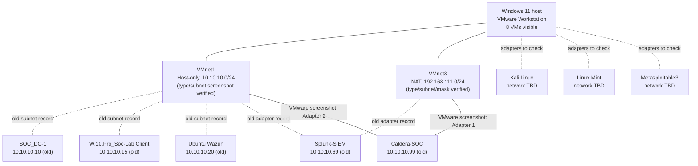

# VMware SOC lab architecture

> **Status: VM inventory and VMware virtual networks screenshot-verified on 23 October 2026.** Individual VM adapter settings (except CALDERA) and guest IP addresses remain unverified.  
> **Evidence:** VMware Workstation Library and Virtual Network Editor screenshots supplied on **23 October 2026**. VM IPs and some connection assumptions below were recorded during the **16–18 October 2026** walkthrough. These older observations are not current guest configuration evidence.

## Purpose and scope

This document describes the virtualised blue-team lab used for Security Operations Centre (SOC) practice: identity services, Windows endpoint logging, security information and event management (SIEM), network monitoring, and authorised adversary simulation.

**Host:** Windows 11 PC running VMware Workstation. The lab was migrated from Hyper-V; older `Internal-Net` / `External-Net` switch information relates to the former environment and should **not** be copied into the current VMware configuration.

## Network inventory — screenshot verified 23 October 2026

The following VMware virtual network settings are **confirmed from the Virtual Network Editor screenshot**, except where specifically qualified:

| Network | Connection type | Subnet shown | Host connection | Local DHCP | Subnet mask | Evidence |
| --- | --- | --- | --- | --- | --- | --- |
| `VMnet1` | Host-only | `10.10.10.0` | Connected | Disabled | `255.255.255.0` (`/24`) | Type, table row and detailed VMnet1 pane |
| `VMnet8` | NAT (Network Address Translation) | `192.168.111.0` | Connected | Enabled | `255.255.255.0` (`/24`) | VMnet8 detailed pane screenshot dated 23 Oct 2026 |

**VMnet1 details:** Host virtual adapter enabled and labelled `VMware Network Adapter VMnet1`; the `Use local DHCP service to distribute IP address to VMs` option is unchecked. VMware displays `10.10.10.0` with `255.255.255.0` mask.

**VMnet8 details:** Network type NAT, host connection Connected, DHCP Enabled and subnet address `192.168.111.0`. A second screenshot, with VMnet8 selected, confirms subnet mask `255.255.255.0` (`/24`), the enabled `VMware Network Adapter VMnet8` host adapter, and the enabled local DHCP service. The **NAT gateway address is not shown** and remains unverified.

**Segmentation note:** Host-only means VMnet1 is not directly bridged to the physical LAN; the VMware host can still communicate over its virtual adapter. Any guest with both host-only and NAT NICs might bridge or route between networks if configured to do so. NAT is not a complete isolation control. Validate guest routes and firewall rules before adversary-emulation exercises.

## VMware Workstation Library — screenshot verified 23 October 2026

The screenshot confirms **eight VM display names** in the current VMware Workstation Library. The names are transcribed as shown, preserving their punctuation. These are **display names**, not necessarily each guest operating system's hostname.

| VM display name — verified screenshot | Intended role / earlier lab history | Last recorded VMnet1 IP (unverified today) | Network adapter details | Evidence |
| --- | --- | --- | --- | --- |
| `Kali Linux` | Authorised attack simulation | Not yet recorded | To check in VM Settings | Visible in Library |
| `Linux Mint` | Wireshark / network monitoring | Not yet recorded | To check in VM Settings | Visible in Library |
| `Metasploitable3` | Deliberately vulnerable training target | Not yet recorded | To check in VM Settings | Visible in Library |
| `SOC_DC-1` | Previously configured Windows Server 2019 / Active Directory Domain Services (AD DS) / DNS | `10.10.10.10` | To check in VM Settings | Name visible; IP from prior notes |
| `Ubuntu Wazuh` | Wazuh manager / dashboard | `10.10.10.20` | To check in VM Settings | Name visible; IP from prior notes |
| `W.10.Pro_Soc-Lab Client` | Windows 10 domain client; guest hostname previously recorded as `DonW10` | `10.10.10.15` | To check in VM Settings | Display name visible; hostname/IP from prior notes |
| `Splunk-SIEM` | Splunk Enterprise | `10.10.10.69` | Previously recorded VMnet1 + VMnet8; recheck | Name visible; connections/IP from prior notes |
| `Caldera-SOC` | MITRE CALDERA adversary emulation | `10.10.10.99` | **Adapter 1: Custom (VMnet8); Adapter 2: Custom (VMnet1)** | **Both adapters screenshot verified**; IP from prior notes |

### Screenshot-verified CALDERA VM details

- **VM display name:** `Caldera-SOC`
- **Power state at capture:** Powered off
- **Allocated memory:** 8 GB
- **Processors:** 4 (VMware summary)
- **Virtual disk:** 60 GB SCSI disk (summary label is truncated; allocation details not independently verified)
- **Network Adapter:** Custom (`VMnet8`)
- **Network Adapter 2:** Custom (`VMnet1`)
- **VM configuration path:** Present in the screenshot but intentionally omitted from the repository to avoid exposing host filesystem details

**Note:** The **VMware Library** screenshot confirms VM names and CALDERA's visible hardware and adapter assignments, **not guest IP addresses**. The later **Virtual Network Editor** screenshot confirms the virtual network types, listed subnet addresses and DHCP settings as described above.

**Previously configured AD domain:** `lab.local` (guest domain membership, DNS settings and current hostnames still require revalidation).

## Architecture diagram — *partially verified as of 23 October 2026*

**Network nodes** now reflect the two Virtual Network Editor screenshots, including both verified `/24` subnet masks. **Solid edges** show CALDERA's VMware adapter connections directly visible in the earlier Library screenshot. **Dashed edges** reflect historical VM membership or adapter records that require live verification. This does not establish live reachability, routing or successful attacks.

## Network adapter evidence — screenshot set from 23 October 2026

See [Network adapter evidence — six unlabelled configurations](adapter-evidence.md) for a transcription of twelve Virtual Machine Settings screenshots, grouped into six two-adapter profiles with memory, CPU and disk details.

**Evidence limitation:** These screenshots show no selected VM name, so they are **not yet tied to individual VMs**. The configuration pair showing a 60 GB SCSI disk, VMnet8 on adapter 1 and VMnet1 on adapter 2 is consistent with the earlier named CALDERA screenshot, but the match is not independent identity confirmation. Keep the named VM inventory above unchanged until direct mapping is provided.

**Safety review:** Before attack simulations, confirm that `Metasploitable3` does not have unnecessary NAT access and that dual-homed VMs cannot unintentionally route traffic between host-only and external networks.

## High-level security data flows — to validate

- `DonW10` Windows Event Logs and Sysmon events → log collection / Wazuh agent and/or Splunk forwarder.
- Wazuh manager → dashboard and alert analysis.
- Splunk forwarder → Splunk receiving port `9997/TCP` (recorded in lab work; validate current listener).
- Splunk web console → `8000/TCP` (recorded in lab work; validate current listener).
- CALDERA ↔ authorised test endpoints only, with network access and endpoint safeguards reviewed in advance.

**No claims are made here that each data flow is currently working.** We will test and document them separately.

## Verification checklist

- [x] Verify all **eight VMware Workstation Library** display names from the screenshot dated 23 October 2026. Raw screenshot was **not** committed because it exposes local host path information.
- [x] Verify **Edit → Virtual Network Editor** screenshots: VMnet1 and VMnet8 connection types, subnet addresses, `/24` masks, connected host adapters and DHCP settings (23 October 2026). NAT gateway address will be checked during guest IP validation.
- [ ] Match all named VMs to network adapters: CALDERA's two are verified from its named Library view; six additional unlabelled two-adapter profiles are documented separately but require name matching.
- [ ] On each VM, record hostname, interface name, IPv4 address/prefix, default gateway and DNS server.
- [ ] Record which adapters are static versus DHCP-assigned.
- [ ] Confirm that the domain client resolves the AD DNS server and that services can reach their expected log destinations.
- [ ] Add a verified network diagram and note the date of the observation.
- [ ] Sanitise screenshots, configuration snippets, routes and addresses before any future public release.

## Step-by-step collection sequence

**Step 4.1 — Current VM inventory: COMPLETE (display names).** A VMware Workstation Library screenshot supplied 23 October 2026 identifies eight VMs. CALDERA's memory, CPU count, disk capacity, power state and two virtual networks were also visible.

**Step 4.2 — VMware virtual networks: COMPLETE.** Both Virtual Network Editor screenshots confirm VMnet1 Host-only (`10.10.10.0/24`, DHCP disabled) and VMnet8 NAT (`192.168.111.0/24`, DHCP enabled), with connected host adapters. NAT gateway address remains unverified and will be checked during Step 4.4.

**Step 4.3 — VM-to-network wiring: IN PROGRESS.** Twelve Hardware-tab screenshots give six network-adapter profiles (see [adapter evidence](adapter-evidence.md)), but the screenshots do **not** display selected VM names. CALDERA's VMnet8 + VMnet1 assignments are independently verified from its earlier Library view. Next, match the remaining configurations to named VMs without guessing.

**Step 4.4 — Guest IP and DNS:** Validate addresses and network routes inside the running VMs; preserve only redacted evidence.

**Step 4.5 — Final map:** Replace this draft with an evidence-based diagram and mark the revision as verified.

## Handling evidence safely

This repository is currently private, but private repositories can still be accidentally shared. Do **not** upload raw VM disks, memory snapshots, password vaults, authentication tokens, private keys, credential-bearing exports, or raw packet captures. Review screenshots for passwords, tokens, public IPs and personal information. Use intentionally sanitised samples for the public-facing portfolio.

## Change history

| Date | Change | Verification |
| --- | --- | --- |
| 2026-10-23 | Initial architecture draft based on earlier VMware walkthrough | Older network and IP values unverified |
| 2026-10-23 | Reconciled eight VM display names and Caldera-SOC summary settings from user-provided VMware Library screenshot | VM names and Caldera-SOC adapters **screenshot verified**; other VM networks and guest IPs pending |
| 2026-10-23 | Confirmed VMnet1 Host-only 10.10.10.0/24 DHCP off; VMnet8 NAT 192.168.111.0 DHCP on, both host connected | First Virtual Network Editor screenshot; VMnet8 mask initially not shown |
| 2026-10-23 | Confirmed VMnet8 subnet mask 255.255.255.0 (/24), connected VMware host adapter and enabled DHCP | Second Virtual Network Editor screenshot; NAT gateway remains unverified |
| 2026-10-23 | Transcribed 12 Virtual Machine Settings screenshots into six pairs of adapters and hardware configurations | Named VM attribution pending because the dialogs do not display VM names |
